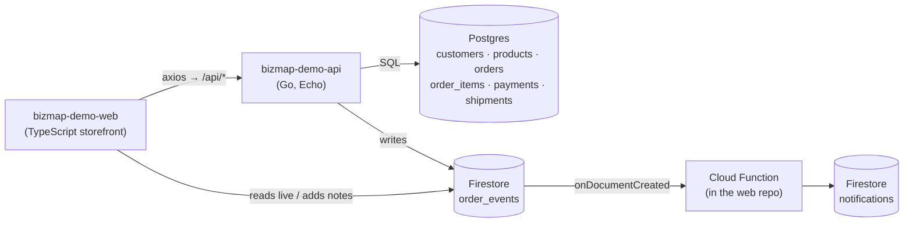

# bizmap-demo-api

Go API (Echo + Postgres + Firestore) for **Northwind Outfitters**, a fictitious
shop. It is half of a two-repo demo of [BizMap](https://github.com/lucas-simao/bizmap):
the other half is the storefront, [bizmap-demo-web](https://github.com/lucas-simao/bizmap-demo-web).

**Live map of both repos:** https://lucas-simao.github.io/bizmap-demo-api/



## Business rules BizMap traces

| Rule | Code | Data |
| --- | --- | --- |
| Gold customers get 10% off, 10+ units get 5% more, capped at 15% | `pricing.go` | `orders.discount_cents`, `orders.total_cents` |
| Placing an order reserves stock; short stock rolls the whole order back | `repo.go` `PlaceOrder` | `products.stock_reserved`, `order_items` |
| Payment turns the reservation into a stock decrement | `repo.go` `RecordPayment` | `payments`, `products.stock_on_hand` |
| `pending → paid → shipped`, `pending/paid → cancelled` | `status.go` | `orders.status` |
| Unpaid orders expire after 30 min (ticker job) | `jobs.go` | `orders.status`, `order_events` |
| Every status change goes to the shared order timeline | `events.go` | Firestore `order_events` |

## What BizMap shows here

- **Who writes a column**, from the route down to the SQL line:
  `bizmap who-writes orders.status` lists the 4 routes and the expiry job.
- **Across repos**: every route is matched to the storefront function that
  calls it over HTTP (7 cross-repo links), and the Firestore collection
  `order_events` is one node written by both repos.
- **Data flow**: `bizmap trace order_events` shows `orders → order_events →
  notifications` (Postgres → Firestore → Cloud Function in the other repo).
- **On every pull request** the [BizMap Action](.github/workflows/bizmap.yml)
  comments with the routes, tables, columns and cross-repo callers the change
  reaches. See the open PRs of this repo and of bizmap-demo-web.

## Try it locally

```bash
pip install bizmap==0.15.1

# one repo
git clone https://github.com/lucas-simao/bizmap-demo-api && cd bizmap-demo-api
bizmap scan . --out bizmap.graph.json
bizmap who-writes orders.discount_cents
bizmap why orders.status

# both repos (what CI and the Pages site use)
git clone https://github.com/lucas-simao/bizmap-demo-web .bizmap/web
bizmap scan .bizmap --out bizmap.graph.json
bizmap who-reads order_events
bizmap trace order_events
bizmap export --format html --config .bizmap/bizmap.yaml --out bizmap.html   # open in a browser
```

### Ask it from Cursor or Claude (MCP)

`.cursor/mcp.json` (Cursor) or `claude mcp add bizmap -- bizmap mcp --graph "$PWD/bizmap.graph.json"` (Claude Code):

```json
{
  "mcpServers": {
    "bizmap": {
      "command": "bizmap",
      "args": ["mcp", "--graph", "${workspaceFolder}/bizmap.graph.json"]
    }
  }
}
```

Then ask: *"what breaks if I change the discount rule?"* or *"who writes order_events?"*.

## Files

- [`bizmap.yaml`](bizmap.yaml): repo name, shared database name, column notes.
- [`.bizmap/bizmap.yaml`](.bizmap/bizmap.yaml): the two-repo workspace.
- [`.github/workflows/bizmap.yml`](.github/workflows/bizmap.yml): PR impact comment.
- [`.github/workflows/pages.yml`](.github/workflows/pages.yml): publishes the map.

## Em português

Demo do BizMap com dois repositórios fictícios (esta API em Go e o
[storefront em TypeScript](https://github.com/lucas-simao/bizmap-demo-web)).
O mapa mostra quem grava cada coluna, as chamadas HTTP do front para a API e a
coleção do Firestore compartilhada entre os dois. Cada PR recebe um comentário
automático com o impacto da mudança.

---

All names and data are fictitious. Run it with `DATABASE_URL` pointing at a
Postgres with `migrations/` applied and Firestore credentials (or the emulator).
